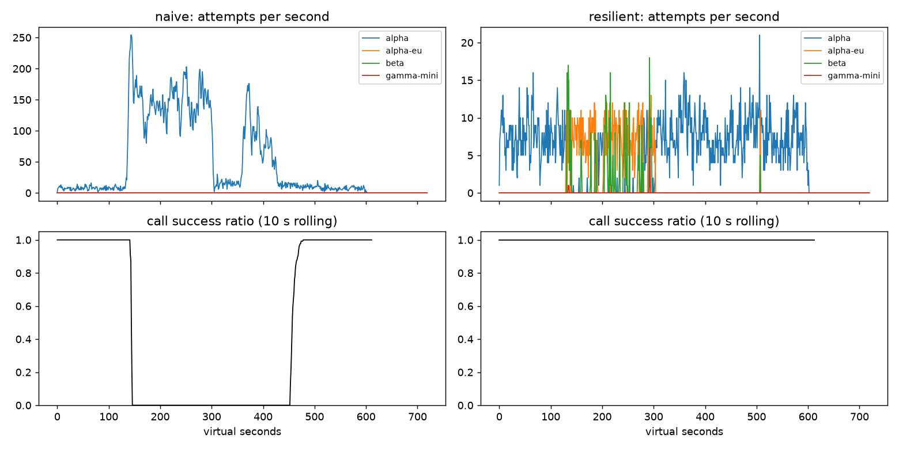

Commit: 5919023bc84d177a753458643d554c200a273e16
Họ tên / nhóm: Nguyễn Quốc Đạt — MSV 2A202602369

# Lab 25B — Game Day report

**Học viên:** Nguyễn Quốc Đạt — 2A202602369. **Ngày:** 13/10/2026.

## 0. Cách tái lập

Python 3.11.9, Windows, seed 25, cấu hình `configs/gameday.yaml`, workload 4 user turn/s và deadline 30 s. Baseline mã nguồn ban đầu: `18cc181`; kết quả sử dụng thay đổi hiện tại trong checkout. Các thí nghiệm chỉ đổi tham số client/cache trong bộ nhớ, không sửa simulator hoặc scenario. Các lệnh dưới chạy từ thư mục gốc sau khi kích hoạt `.venv`:

```powershell
python -m pip install -e ".[dev,plot]"
python -m pytest -q
python scripts/run_gameday.py --client both
python scripts/run_workflows.py --executor both
python scripts/run_slo.py --alerter both
python scripts/run_gameday.py --scenarios configs/scenarios_cache.yaml --client resilient,cached --out reports/cache
python scripts/run_report_experiments.py
python scripts/plot_timeseries.py --scenario G2_overload_storm
python scripts/grade.py
python scripts/build_report.py
```

Đã chạy 82 test: tất cả pass. Grader công khai đạt 84/88 automatic points; 4 điểm SLO ẩn chưa chấm và 12 điểm report do giảng viên chấm tay. Không suy diễn điểm dữ liệu ẩn từ public PASS. Thí nghiệm Part F lưu tại `reports/experiments/part_f.json`; cache lưu từng JSON tại `reports/cache/experiments/`.

## 1. Kết quả Game Day (naive vs resilient)


| Băng | Client | Availability | p95 s | Amplification | Retry ratio | Cost/good turn | Recovery s | PASS |
| --- | --- | --- | --- | --- | --- | --- | --- | --- |
| G1_rate_limit_spike | naive | 0.7194 | 7.157 | 7.738 | 6.738 | 2.163 | 4.0 | False |
| G1_rate_limit_spike | resilient | 1.0 | 4.738 | 1.063 | 0.002 | 2.106 | 0.0 | True |
| G2_overload_storm | naive | 0.456 | 15.034 | 9.904 | 8.904 | 4.627 | 155.0 | False |
| G2_overload_storm | resilient | 1.0 | 8.939 | 1.046 | 0.009 | 2.133 | 0.0 | True |
| G3_brownout | naive | 1.0 | 4.768 | 1.164 | 0.164 | 2.328 | 0.0 | False |
| G3_brownout | resilient | 1.0 | 4.621 | 1.058 | 0.03 | 2.14 | 0.0 | True |
| G4_slow_region | naive | 1.0 | 13.764 | 1.004 | 0.004 | 2.008 | 0.0 | False |
| G4_slow_region | resilient | 1.0 | 5.604 | 1.029 | 0.004 | 2.101 | 0.0 | True |
| G5_bad_deploy_then_quota | naive | 0.3699 | 5.359 | 17.03 | 16.03 | 2.124 | None | False |
| G5_bad_deploy_then_quota | resilient | 0.8179 | 5.477 | 1.003 | 0.003 | 2.504 | None | True |
| G6_provider_outage | naive | 0.517 | 4.836 | 12.344 | 11.344 | 2.009 | 0.0 | False |
| G6_provider_outage | resilient | 1.0 | 5.941 | 1.058 | 0.022 | 2.207 | 0.0 | True |


Availability đo user turn hoàn tất đúng; p95 đo các turn thành công nên phải đọc cùng availability và give_up_reasons. G5 chứa request malformed không thể sửa bằng retry: resilient availability 81.79% vẫn đạt yêu cầu; không cố failover lỗi 400. Recovery là cửa sổ 30 s đầu tiên sau restore có call success ≥95%, không phải thời gian mọi turn trở lại bình thường.

## 2. Cấu hình client và quyết định theo lỗi

| Tham số | Giá trị | Lý do và số liệu |
|---|---|---|
| attempt_timeout_s | 6 | Thử 8 → 6 s: G2 p95 10.362 → 8.939, availability giữ 100%; cost/turn 2.112 → 2.133. G6 p95 5.961 → 5.941. |
| max_attempts_per_provider | 2 | Tối đa một retry cùng provider trước failover. G3 retry ratio 0.030, amplification 1.058. |
| min_time_left_s | 1 | Chặn gửi khi còn dưới 1 s; timeout cũng bị giới hạn bởi deadline. G6 cấu hình chọn không có GiveUp. |
| backoff_base_s / cap_s | 0.25 / 4 | Full jitter tránh đồng loạt retry; retry_after luôn là sàn, cộng jitter 0–0.25 s. G1 không vi phạm retry-after. Với hai attempt, cap chủ yếu bảo vệ khi tăng retry count. |
| retry_budget_ratio / min_per_s / max_tokens | 0.1 / 0.5 / 20 | Request đầu nạp token, retry tiêu một token; refill cho lưu lượng thấp. G2 retry ratio 0.009. Thí nghiệm stress ở mục 3 đo tác dụng khi breaker không chặn sớm. |
| quota_cooldown_s | 300 | Quota không retry; cooldown account/provider, chuyển sang nơi khác. G5 availability 0.8179, không retry lỗi client. |
| breaker.window_size / min_calls | 20 / 10 | Cửa sổ gần nhất, đủ mẫu trước trip; G2 amplification 1.046, recovery 0 s. |
| failure_rate_threshold | 0.5 | Trip khi nửa kết quả gần nhất lỗi; G6 availability 100%. |
| slow_call_s / slow_rate_threshold | 5 / 0.6 | Thành công chậm cũng báo sức khỏe xấu; G4 p95 5.604 so với naive 13.764 s. |
| open_duration_s | 10 | Tạm ngừng traffic rồi probe; G2 và G6 recovery 0 s theo phép đo cửa sổ. |
| half_open_max_probes / half_open_successes | 2 / 2 | Giới hạn probe đang bay và cần hai thành công nhanh để CLOSED. 13 test breaker pass. |

Ngoài timeout, các giá trị giữ từ starter đã đạt 6/6 băng; kết quả tổng hợp không chứng minh từng tham số là tối ưu riêng lẻ.

| Lỗi | Tính breaker? | Retry cùng provider? | Hành động |
|---|---|---|---|
| 400/401/422 và lỗi client | Không | Không | GiveUp; không failover request sai |
| 429 insufficient_quota | Không | Không | Cooldown 300 s, failover |
| 429 rate limit | Không | Không | Cooldown theo retry_after, failover; chỉ chờ cooldown ngắn nếu không còn nơi gửi |
| 529/503, 5xx, timeout | Có | Có nếu còn lượt, budget và deadline | Backoff hoặc failover; skip breaker OPEN |

Chỉ một tầng retry trong ResilientClient. Ladder `[alpha, alpha-eu, beta, gamma-mini]` lọc tool capability: gamma-mini chỉ nhận chat. Generation cũ bị bỏ qua; cancel trả slot HALF-OPEN.

## 3. Thí nghiệm

### 3.1 Bật/tắt retry budget

Đối chứng chính giữ cấu hình hiện tại; nhánh tắt dùng ratio=100, max_tokens=1e9, min_per_s=1e6 để budget thực tế không giới hạn. Không thay workload hay scenario. Stress bổ sung giữ cả hai nhánh ở max_attempts=5 và breaker.min_calls=1e9 (breaker thực tế không trip); đây là phép thử tác dụng riêng của budget, không phải cấu hình nộp bài.


| Nhánh | Băng | Avail | p95 | Ampl | Retry | Cost/turn | Recovery |
| --- | --- | --- | --- | --- | --- | --- | --- |
| normal_budget_on | G2_overload_storm | 1.0 | 8.939 | 1.046 | 0.009 | 2.133 | 0.0 |
| normal_budget_on | G3_brownout | 1.0 | 4.621 | 1.058 | 0.03 | 2.14 | 0.0 |
| normal_budget_off | G2_overload_storm | 1.0 | 8.896 | 1.046 | 0.009 | 2.133 | 0.0 |
| normal_budget_off | G3_brownout | 1.0 | 4.696 | 1.059 | 0.035 | 2.138 | 0.0 |
| budget_on | G2_overload_storm | 1.0 | 15.621 | 1.4 | 0.06 | 2.391 | 0.0 |
| budget_on | G3_brownout | 1.0 | 4.55 | 1.136 | 0.068 | 2.271 | 0.0 |
| budget_off | G2_overload_storm | 0.9733 | 18.638 | 1.672 | 0.442 | 2.615 | 42.0 |
| budget_off | G3_brownout | 1.0 | 4.661 | 1.162 | 0.158 | 2.322 | 0.0 |


Trong cấu hình chọn, breaker và một retry/provider đã hạn chế tải nên bật/tắt budget gần như không đổi G2 (retry 0.009 cả hai). G3 tăng 0.030 → 0.035 khi bỏ budget. Không thể kết luận budget vô dụng từ tác động nhỏ này. Trong stress G2, bỏ budget làm amplification 1.400 → 1.672, retry 0.060 → 0.442, recovery 0 → 42 s và 63 lượt deadline; availability 100% → 97.33%. Retry thêm gây áp lực lên provider đang thiếu năng lực. G3 stress retry tăng 0.068 → 0.158 nhưng availability vẫn 100%: brownout không gây quá tải giống G2. Budget là một lớp bảo vệ độc lập bên cạnh breaker.

### 3.2 Timeout và khả năng fallback: G6, đối chứng G4

Nhánh timeout_30 chỉ đổi attempt_timeout_s từ 6 lên 30; nhánh unfiltered chỉ bỏ lọc tool capability, giữ timeout 6. Các nhánh đều seed 25.


| Nhánh | Băng | Availability | GiveUp reasons | p95 s | Incompatible routes |
| --- | --- | --- | --- | --- | --- |
| selected_6s | G4_slow_region | 1.0 | {} | 5.604 | 0 |
| timeout_30 | G4_slow_region | 1.0 | {} | 5.608 | 0 |
| selected_6s | G6_provider_outage | 1.0 | {} | 5.941 | 0 |
| timeout_30 | G6_provider_outage | 0.9488 | {'deadline': 107, 'no_provider_available': 15} | 5.44 | 0 |
| unfiltered | G6_provider_outage | 0.8948 | {'incompatible_model_output': 251} | 5.673 | 251 |


G6 timeout 30 s giảm availability từ 1.0 xuống 0.9488, với 107 deadline và 15 no_provider_available. p95 lại giảm 5.941 → 5.440: turn treo thất bại không góp vào p95 thành công, nên đây không phải cải thiện trải nghiệm. alpha-eu hang tiêu hết deadline trước khi có cơ hội dùng B. G4 là đối chứng: provider vẫn trả lời chậm, breaker phát hiện slow success; availability 1.0 cả hai và p95 gần nhau 5.604/5.608. Bỏ capability filter ở G6 tạo 251 incompatible_model_output, availability 0.8948; model chat rẻ không thể thay model tool dù p95 còn thấp.

## 4. Workflow exactly-once


| Executor | Completion | Crashes | Duplicate refunds | Duplicate emails | Lost refunds | Overpaid cents | Wasted LLM/crash | PASS |
| --- | --- | --- | --- | --- | --- | --- | --- | --- |
| naive | 1.0 | 81 | 128 | 81 | 0 | 1574200 | 1.123 | False |
| yours | 1.0 | 66 | 0 | 0 | 0 | 0 | 0.303 | True |


500 session, seed 25. Key JSON `(session_id, step)` ổn định và không nhập nhằng khi ID chứa dấu phân cách. Checkpoint chỉ ghi sau thành công; resume đọc DurableStore để bỏ qua bước đã xong. Nếu tiền đã chuyển nhưng response mất/crash trước checkpoint, gọi lại cùng key để dịch vụ trả kết quả cũ. Chỉ bắt ServiceError/ServiceTimeout, không bắt WorkerCrash. Wasted LLM/crash giảm 1.123 → 0.303. Chỉ idempotency key chưa đủ vì không ghi tiến độ thì worker vẫn chạy lại các bước LLM và tăng chi phí; chỉ checkpoint chưa đủ vì khe hở side effect–checkpoint có thể gây trả tiền hai lần. Ghi checkpoint trước payment thì crash giữa hai thao tác khiến resume bỏ qua payment chưa chạy và mất hoàn tiền. Exactly-once side effect dựa trên dịch vụ hỗ trợ idempotency.

## 5. SLO và error budget

SLO 99.5%, dữ liệu 43.200 phút. Prefix sum O(n) xây dựng, O(1) mỗi cửa sổ; tỷ lệ lỗi được tính theo tổng request, không trung bình tỷ lệ từng phút. Zero traffic cho burn rate 0. Luật page 14.4× (60m & 5m), page 6× (360m & 30m), ticket 1× (4320m & 360m); hai cửa sổ cùng vượt ngưỡng mới firing. Cửa sổ dài lọc blip, cửa sổ ngắn xác nhận vẫn có tác động.


| Alerter | Pages | Tickets | False pages | PASS |
| --- | --- | --- | --- | --- |
| naive | 7 | 0 | 3 | False |
| burnrate | 3 | 1 | 0 | True |

| Incident | Kỳ vọng | Naive | Burn rate | Delay naive/burn phút |
| --- | --- | --- | --- | --- |
| checkout_bug | page | phát hiện | phát hiện | 1 / 27 |
| provider_outage | page | phát hiện | phát hiện | 0 / 4 |
| deploy_blip | none | false page | không page | — / — |
| slow_leak | ticket | bỏ sót | phát hiện | None / 1337 |
| degraded_evening | page | phát hiện | phát hiện | 214 / 291 |
| night_spike | none | false page | không page | — / — |
| small_bump | none | false page | không page | — / — |


25,901,755 request; allowed bad 129,508.8; bad 55,618. Availability 99.7853%, budget tiêu 42.95%, còn 57.05% → không freeze release. Ngân sách cạn (remaining ≤ 0) thì freeze. small_bump 20 phút ở 12% lỗi không đủ tác động kéo dài: với baseline/traffic tương đương, burn rate 1h khoảng 8×, dưới 14.4×; 6h khoảng 1.33×, dưới 6×. Cửa sổ dài không firing nên không page dù 5 phút nhìn xấu; public scoring xác nhận không page. Các con số 8×/1.33× là minh họa với traffic đều, thuật toán thực dùng request-weighted sums. Hidden SLO chưa chạy vì không có dữ liệu, không đánh đồng 0 false page public với bảo đảm mọi phân phối traffic.

## 6. Postmortem blameless — G2 với naive

### Tóm tắt và tác động

Mô phỏng alpha mất 75% GPU từ t=120 đến t=300 s. Baseline không có cơ chế giới hạn retry theo sức khỏe provider; các lớp app/gateway/SDK cùng retry, giữ traffic trên alpha. Đây là thiếu sót thiết kế và cấu hình kiểm soát tải, không quy trách nhiệm cá nhân.

Trong 600 s có 2,362 user turn, 1,077 thành công (45.60%); 1,285 lượt không hoàn tất đúng. 3,481 logical call tạo 34,475 attempt, amplification 9.904 và retry ratio 8.904. 26,298 rate-limit error, 3,194 overload, 2,737 timeout; 28,381 vi phạm retry-after. Call GiveUp gồm 655 retries_exhausted và 585 deadline; các số call không cộng trực tiếp với turn do workflow nhiều call. Cost/good turn 4.627 so với resilient 2.133.

### Timeline và bằng chứng



Nguồn: `reports/gameday/naive_G2_overload_storm_timeseries.csv` và CSV resilient tương ứng. Đồ thị là call success ratio theo cửa sổ 10 s; availability tổng là user turn, hai thước đo khác nhau.

| Thời điểm ảo | Quan sát naive |
|---|---|
| t=119 | alpha 9 attempts/s, rolling call success 100% |
| t=120 | Bắt đầu mất năng lực; 5 attempts/s, kết quả đang hoàn tất còn 100% |
| t=150 | 163 attempts/s, rolling success 0/50; retry storm đã hình thành |
| t=240 | 105 attempts/s, rolling success 0/56 |
| t=300 | Năng lực được khôi phục nhưng 115 attempts/s, success 0/43 |
| t=330 | 6 attempts/s, success 0/27; mẫu một giây thấp không chứng minh hồi phục |
| t=400 | 51 attempts/s, success 0/49; backlog và retry vẫn kéo dài |
| t=455 | Rolling success 12/40 (30%); recovery metric bắt đầu cửa sổ 30 s đạt 95% |
| t=480 | Rolling success 137/137 (100%) |

Recovery metric là 155 s sau restore (t=455 bắt đầu cửa sổ 30 s), không mâu thuẫn với cửa sổ nhìn lùi 10 s ở cùng thời điểm còn thấp. Resilient recovery 0 s theo metric, amplification 1.046 và availability 100%.

### Nguyên nhân và điều kiện góp phần

Trigger là mất 75% GPU; root cause là retry ba tầng không jitter/budget/breaker. Giảm năng lực làm hàng đợi chậm, timeout/529; retry nhân qua ba tầng tăng attempt, tạo rate limit và tiếp tục retry không tôn trọng retry-after. Sau t=300, hàng đợi vẫn chứa request mà client đã timeout/bỏ cuộc; công việc cũ tiếp tục chiếm tài nguyên trong khi retry giữ tải vượt năng lực. Khôi phục GPU chưa xóa được backlog và feedback loop, nên hệ thống ở trạng thái metastable. Không có breaker phát hiện failure/slow call và không có budget giới hạn retry. Không failover sang provider lành mạnh; alpha nhận toàn bộ 34,475 attempt.

### Phát hiện, giảm tác động và phòng ngừa

Trong thực tế cần alert burn rate user SLI đồng thời quan sát queue latency, timeout/529/429, attempt/logical call và retry-after violations. Đây là đề xuất vận hành; không gán cảnh báo SLO 30 ngày cho timestamp G2 khi chưa có phép đo tương ứng. Biện pháp trong lab là một tầng retry, full jitter, cooldown, budget, breaker và fallback theo capability.

| Hành động đề xuất | Nhóm | Chủ sở hữu vai trò | Ưu tiên | Tiêu chí kiểm chứng |
|---|---|---|---|---|
| Loại retry chồng tầng | Prevent | Client team | P0 | Chỉ ResilientClient retry; G2 amplification ≤1.2 trong CI |
| Tôn trọng retry-after và quota | Prevent | Client team | P0 | G1 zero violations; 400 không retry/failover |
| Budget + breaker failure/slow | Mitigate | Reliability team | P0 | G2 recovery ≤30 s; G4 p95 ≤10 s; probe concurrency test |
| Fallback có capability và timeout | Mitigate | Client team | P0 | G6 availability ≥95%, incompatible routes=0 |
| Dashboard attempt ratio và burn rate | Detect | On-call/SRE | P1 | Major incident page đúng hạn, zero false page blip |
| Capacity drill và failure injection | Prevent | Platform team | P1 | Chạy đa seed, outage mọi provider, tải vượt baseline |

Đây là action item đề xuất theo vai trò, chưa có lịch triển khai production. Public lab đã kiểm chứng các biện pháp client; dashboard/capacity drill production chưa được triển khai trong repo.

## 7. Giới hạn và bước tiếp theo

G2 resilient vẫn p95 8.939 s và cost tăng khi failover, không phải mọi metric đều tối ưu. G6 vẫn phụ thuộc beta khi family A hỏng; nếu B cũng không đáp ứng, tool turn không thể dùng gamma-mini. Cache giữ FAQ công khai nhưng không cứu câu cá nhân và tool. Ngưỡng cosine 0.90 chỉ kiểm chứng trên catalog/seed hiện có; cần bộ FAQ thực tế và đánh giá false hit trước triển khai. Hidden SLO và các seed/scenario khác chưa xác nhận. DurableStore mô phỏng không thay thế kiểm chứng durability/concurrency thật. Tiếp theo đo đa seed/tải, giảm tail latency với deadline-aware routing, và kiểm thử tính đúng side effect khi nhiều worker đồng thời.

## 8. Cache (Part G)


| Client | Avail | FAQ avail | Hit ratio | Stale | Wrong | Outdated | Cost/turn | PASS |
| --- | --- | --- | --- | --- | --- | --- | --- | --- |
| resilient | 0.8373 | 0.8424 | 0.0 | 0 | 0 | 0 | 1.386 | False |
| cached | 0.9124 | 0.9645 | 0.652 | 157 | 0 | 3 | 0.915 | True |


| Cache parameter | Giá trị | Lý do |
|---|---|---|
| similarity_threshold | 0.90 | 0 wrong; hit 0.652. Ngưỡng 0.80 có 157 other_question, 0.97 giảm hit còn 0.581. |
| ttl_s | 60 | 3 outdated và hit 0.652. TTL 300 có 95 outdated; TTL 30 có 2 outdated nhưng hit chỉ 0.592. |
| max_stale_s | 300 | FAQ availability 96.45%, 157 stale served; tắt stale còn 87.33%. |
| max_entries | 500 | Giới hạn kích thước, LRU loại entry ít dùng; unit test kiểm chứng eviction. Chưa sweep capacity riêng. |

Cấu hình starter 0.80/600/0 có 181 other_question, 80 outdated, FAQ availability 85.87%. Chỉnh từng biến trong các thí nghiệm dưới, giữ hai biến khác ở cấu hình chọn và seed 25:


| Nhánh | FAQ availability | Hit ratio | Wrong | Outdated | Cost/turn | Stale |
| --- | --- | --- | --- | --- | --- | --- |
| threshold_080 | 0.8733 | 0.666 | 157 | 1 | 0.965 | 152 |
| threshold_090 | 0.9645 | 0.652 | 0 | 3 | 0.915 | 157 |
| threshold_097 | 0.964 | 0.581 | 0 | 4 | 0.964 | 153 |
| ttl_30 | 0.9645 | 0.592 | 0 | 2 | 0.955 | 192 |
| ttl_60 | 0.9645 | 0.652 | 0 | 3 | 0.915 | 157 |
| ttl_300 | 0.964 | 0.731 | 0 | 95 | 0.863 | 68 |
| stale_0 | 0.8733 | 0.561 | 0 | 3 | 0.975 | 0 |


**Ngưỡng:** embedding các intent khác nhau được cố ý đặt gần, ví dụ refund policy/return policy, phí ship nội/ngoại tỉnh. 0.80 trả `other_question`; chưa ghi log từng text nên không khẳng định câu cụ thể nào thuộc 157 lượt lỗi. 0.90 loại false hit trên C1 mà hit cao hơn 0.97; cost 0.915 so với 0.964 ở 0.97. Không lựa chọn ngưỡng chỉ theo hit ratio.

**TTL:** webhook lúc t=150 invalidate source hoàn tiền nên tránh ignored_invalidation. Bảng phí ship đổi t=480 không có webhook: cache không có tín hiệu để xóa, chỉ TTL buộc refresh trong policy hiện tại. TTL dài tăng hit/cắt cost nhưng lỗi thời nhiều; 60 s cân bằng và đạt giới hạn ≤15. Invalidation không giải quyết thay đổi không được thông báo.

**Stale-if-error:** outage t=240–360 dài 120 s, entry có thể đã stale trước outage; cửa sổ 300 s giữ khả năng cứu FAQ khi inner GiveUp. Tắt stale làm FAQ availability giảm 96.45% →87.33% và hit 65.2% →56.1%, dù wrong vẫn 0. Câu cũ chỉ dùng sau GiveUp và còn trong TTL+max_stale_s, không dùng stale thay call thành công.

**Tính đúng:** scope prompt_version tránh old_prompt khi deploy t=420. Request.personal bị loại hoàn toàn; scope user vẫn không bảo đảm trạng thái đơn/refund hiện tại và không thay việc xác minh dữ liệu riêng. Invalidate theo source tránh ignored_invalidation; LRU cập nhật khi hit, giới hạn max_entries. 17 test cache pass; C1 zero wrong ở cấu hình chọn.

**Quan sát khi dashboard xanh nhờ cache:** theo dõi provider attempt error/timeout rate, breaker OPEN, stale-served rate và tuổi entry; tách fresh hit, stale fallback, provider success và user success. User FAQ availability cao không có nghĩa provider khỏe. Không cache câu cá nhân hay tool turn nên availability tổng 91.24% thấp hơn FAQ 96.45%.
